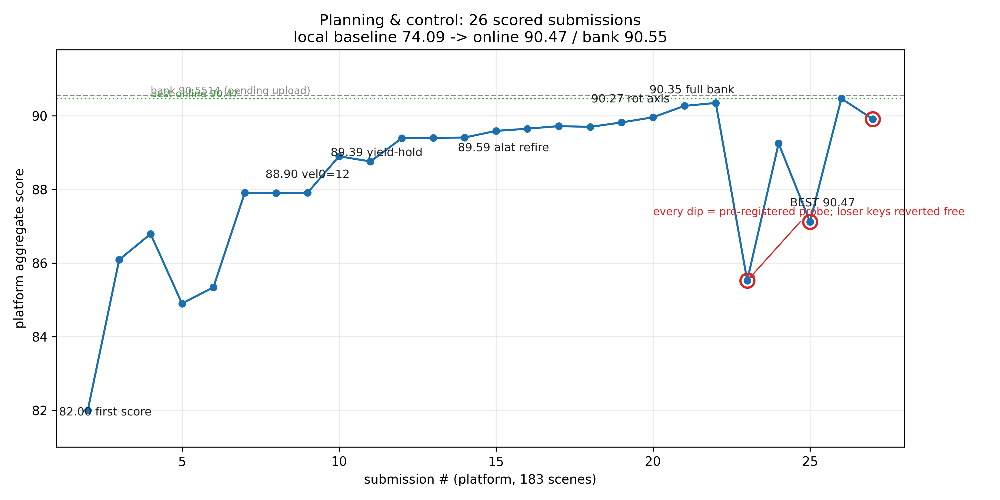
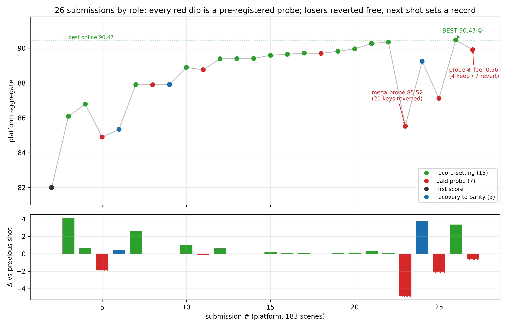
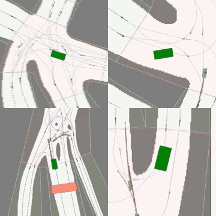
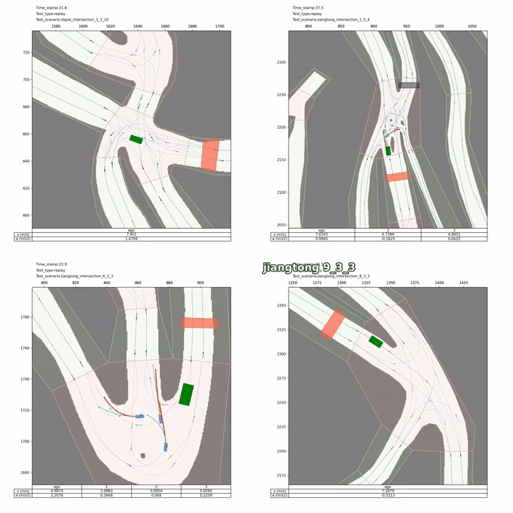

# MineSim-MPC-AD — 矿区自动驾驶规控策略（基于 MineSim）

<p align="center">
  <a href="README.md"></a>
  <a href="README_en.md"></a>
</p>

> **赛题**：[琶洲算法大赛 × 智能驾驶生态赛](https://www.aicompetition-pz.com/topic_detail/56) — **决策规划控制**任务（MineSim 回放仿真）。大赛官网：[aicompetition-pz.com](https://www.aicompetition-pz.com/) · 赛题页：[topic_detail/56](https://www.aicompetition-pz.com/topic_detail/56)。
>
> **概述**：在官方 MineSim / mine_sim V1.1 上集成的**规控策略**——按场景自适应参数、SAS 闭环候选搜索、STPP / 轨迹重定时，以及 v63 全轨迹 SQP 与目标区域精修。本仓已含可运行仿真树（`devkit/` + 公开 `inputs/` + 地图），**克隆一次即可跑**。
>
> **成绩**：线上版本 **v58 ≈ 96.12**（183 场均分 96.121366…）· 本地最佳 **v63** 公开 40 场 ≈ **97.57** / 本地 43 场 ≈ **97.10**（零碰撞、零压界；v63 **未**作为线上提交版本）。
>
> **怎么跑**（无需再下官方包）：
>
> ```bash
> git clone https://github.com/cainiao33/MineSim-MPC-AD-Control.git
> cd MineSim-MPC-AD-Control
> pip install -r setup/requirements.txt
> python devkit/__main__.py --scenario Scenario-dapai_intersection_1_3_10.json --visualize none
> ```
>
> 演示视频：[跟随镜头](https://github.com/cainiao33/MineSim-MPC-AD-Control/releases/tag/v63-demo-videos) · [全景视角](https://github.com/cainiao33/MineSim-MPC-AD-Control/releases/tag/v63-demo-videos-wide)；任务与数据：[TASK_AND_DATA.md](TASK_AND_DATA.md)；方法：[METHOD.md](METHOD.md) / [ARCHITECTURE.md](ARCHITECTURE.md)。

[](https://www.python.org/downloads/)
[](LICENSE)
[](https://www.aicompetition-pz.com/topic_detail/56)
[](NOTICE)
[](SCORES.md)

---

## 📖 项目简介

本项目是 **[琶洲算法大赛 × 智能驾驶生态赛](https://www.aicompetition-pz.com/topic_detail/56)** **决策规划控制**赛道方案的开源代码：在 MineSim 回放仿真上，用可解释的规则方法与按场景管理的参数配置，将成绩从早期基线提升到线上 **v58 ≈ 96.12**、本地 **v63 ≈ 97.1**（43 场）。

技术路线：基于官方 mine_sim V1.1，**不改仿真环境与评分器**；策略改动集中在 `planner` / `predictor` / `simple_control`，并加入 SAS、STPP、全轨迹 SQP 等模块。本仓已打好补丁，并附带公开 40 场 `inputs/`、两矿区地图与完整 183 场 `scen_config.json`。

### 相对官方 `devkit/` 的主要改动

- **🗺 路径规划**：按场景选择 `modes`（base / center / hybrid），配合离线中线表与局部修正表 `centerlines_*_v2s.json`
- **⏱ 速度与跟车**：`vel0` / `vprof` / IDM / 让行等参数；单变量对比实验，有效配置保留、无效配置回滚
- **🛡 安全跟踪**：侧向加速度、转角、预瞄等约束，与评分侧相关项对齐
- **🔁 SAS v2**：在同一套车辆模型、控制器与评分器上做闭环候选搜索，按决策时间窗择优
- **📐 STPP + 轨迹重定时**：在安全约束下调整执行时序（v58 线上主版本）
- **🎯 v63 全轨迹 SQP + 目标区域**：对已通过安全检查的轨迹做目标区域精修，保留切换迟滞，避免强行换策略

> 线上 183 场中的**隐藏场景**与平台评测服务不在本仓。许可证 AGPL-3.0，见 [LICENSE](LICENSE) / [NOTICE](NOTICE)；上游说明见 [UPSTREAM_README.md](UPSTREAM_README.md)。

---

## 🏆 竞赛成果

| 项 | 内容 |
|------|------|
| **赛事** | [琶洲算法大赛 × 智能驾驶生态赛](https://www.aicompetition-pz.com/topic_detail/56) |
| **赛道** | 决策规划控制（初赛 B / 决赛 B） |
| **官方链接** | [赛题详情](https://www.aicompetition-pz.com/topic_detail/56) · [大赛官网](https://www.aicompetition-pz.com/) |

| 指标 | 成绩 |
|------|------|
| **线上版本** | **v58 ≈ 96.12**（183 场均分 96.121366…） |
| **本地公开 40 场** | **v63 = 97.572355** |
| **本地 43 场** | **v63 = 97.096258…**（全部到达 · 零碰撞 · 零压界） |
| **早期公开集** | 基线约 74 → 约 90.23（本地公开 40，过程记录） |
| **线上演进** | 首评 82.00 → … → v54 ≈ 95.996 → **v58 ≈ 96.12** |

请区分：**本地 43 场均分 ≠ 线上 183 场均分**；v63 是本地最佳，**不是**已提交的线上版本。详见 [SCORES.md](SCORES.md)。

<p align="center">
  
</p>
<p align="center"><sub>线上提分曲线 · 下方为提交类型示意</sub></p>

<p align="center">
  
</p>

---

## 📋 任务场景与规控数据集

| 项 | 内容 |
|------|------|
| **赛事** | [琶洲算法大赛 × 智能驾驶生态赛](https://www.aicompetition-pz.com/topic_detail/56) |
| **任务** | 结合感知结果、位姿、导航与动力学，在无信号灯路口与动态交互场景输出转向、油门、制动 |
| **评分** | 安全性 50% + 效率性 30% + 路径完成度 20% |
| **数据集（官方）** | 位姿序列、导航指令、动力学状态、感知结果；非结构化道路无信号灯路口；初/决赛字段一致、分布不同 |
| **公开包** | 两张地图（大排 / 江铜）· **40** 个公开场景 · baseline 与说明文档；线上评测约 **183** 场 |
| **本仓演示 11 场** | 大排 `1_3_10/1_3_15/2_3_5/3_2_2` · 江铜 `1_5_3/1_5_4/5_4_1/6_2_5/6_3_3/9_3_2/9_3_3` |

完整说明见 [TASK_AND_DATA.md](TASK_AND_DATA.md)。公开 40 场与两矿区地图已随仓提供；隐藏评测场不在本仓。

---

## 🎥 演示效果

两种视角，对应同一套 v63 已验证轨迹；渲染后处理不改变仿真结果。

| 视角 | 说明 | 完整视频 |
|------|------|----------|
| **跟随镜头** | 锁定自车、平滑跟拍、1080²，便于观察近车运动 | [Release `v63-demo-videos`](https://github.com/cainiao33/MineSim-MPC-AD-Control/releases/tag/v63-demo-videos)（约 144MB） |
| **全景 / 地图视角** | 1500² 宽幅，便于查看路网、背景车与整段路线 | [Release `v63-demo-videos-wide`](https://github.com/cainiao33/MineSim-MPC-AD-Control/releases/tag/v63-demo-videos-wide)（`wide_*`，约 55MB） |

### 跟随镜头预览

<p align="center">
  
</p>
<p align="center"><sub>2×2：大排 1_3_10 · 大排 3_2_2 · 江铜 1_5_4 · 江铜 6_3_3（到达段）</sub></p>

完整混剪：[`v63_highlights_1080.mp4`](https://github.com/cainiao33/MineSim-MPC-AD-Control/releases/download/v63-demo-videos/v63_highlights_1080.mp4)

### 全景 / 地图视角预览

<p align="center">
  
</p>
<p align="center"><sub>2×2：大排 1_3_10 · 江铜 1_5_4 · 江铜 6_3_3 · 全景混剪节选</sub></p>

完整全景混剪：[`wide_v63_highlights_1080.mp4`](https://github.com/cainiao33/MineSim-MPC-AD-Control/releases/download/v63-demo-videos-wide/wide_v63_highlights_1080.mp4)

### 成片清单（11 场 × 双倍速 × 双视角）

每场提供 **1x 实时** 与 **0.5x 慢放**。跟随镜头无文件名前缀；全景文件名带 `wide_`。

| 场景 | 地图 | 跟随 1x | 全景 1x |
|------|------|---------|--------|
| 1_3_10 | 大排 | [mp4](https://github.com/cainiao33/MineSim-MPC-AD-Control/releases/download/v63-demo-videos/v63_dapai_intersection_1_3_10_1x.mp4) | [mp4](https://github.com/cainiao33/MineSim-MPC-AD-Control/releases/download/v63-demo-videos-wide/wide_v63_dapai_intersection_1_3_10_1x.mp4) |
| 1_3_15 | 大排 | [mp4](https://github.com/cainiao33/MineSim-MPC-AD-Control/releases/download/v63-demo-videos/v63_dapai_intersection_1_3_15_1x.mp4) | [mp4](https://github.com/cainiao33/MineSim-MPC-AD-Control/releases/download/v63-demo-videos-wide/wide_v63_dapai_intersection_1_3_15_1x.mp4) |
| 2_3_5 | 大排 | [mp4](https://github.com/cainiao33/MineSim-MPC-AD-Control/releases/download/v63-demo-videos/v63_dapai_intersection_2_3_5_1x.mp4) | [mp4](https://github.com/cainiao33/MineSim-MPC-AD-Control/releases/download/v63-demo-videos-wide/wide_v63_dapai_intersection_2_3_5_1x.mp4) |
| 3_2_2 | 大排 | [mp4](https://github.com/cainiao33/MineSim-MPC-AD-Control/releases/download/v63-demo-videos/v63_dapai_intersection_3_2_2_1x.mp4) | [mp4](https://github.com/cainiao33/MineSim-MPC-AD-Control/releases/download/v63-demo-videos-wide/wide_v63_dapai_intersection_3_2_2_1x.mp4) |
| 1_5_3 | 江铜 | [mp4](https://github.com/cainiao33/MineSim-MPC-AD-Control/releases/download/v63-demo-videos/v63_jiangtong_intersection_1_5_3_1x.mp4) | [mp4](https://github.com/cainiao33/MineSim-MPC-AD-Control/releases/download/v63-demo-videos-wide/wide_v63_jiangtong_intersection_1_5_3_1x.mp4) |
| 1_5_4 | 江铜 | [mp4](https://github.com/cainiao33/MineSim-MPC-AD-Control/releases/download/v63-demo-videos/v63_jiangtong_intersection_1_5_4_1x.mp4) | [mp4](https://github.com/cainiao33/MineSim-MPC-AD-Control/releases/download/v63-demo-videos-wide/wide_v63_jiangtong_intersection_1_5_4_1x.mp4) |
| 5_4_1 | 江铜 | [mp4](https://github.com/cainiao33/MineSim-MPC-AD-Control/releases/download/v63-demo-videos/v63_jiangtong_intersection_5_4_1_1x.mp4) | [mp4](https://github.com/cainiao33/MineSim-MPC-AD-Control/releases/download/v63-demo-videos-wide/wide_v63_jiangtong_intersection_5_4_1_1x.mp4) |
| 6_2_5 | 江铜 | [mp4](https://github.com/cainiao33/MineSim-MPC-AD-Control/releases/download/v63-demo-videos/v63_jiangtong_intersection_6_2_5_1x.mp4) | [mp4](https://github.com/cainiao33/MineSim-MPC-AD-Control/releases/download/v63-demo-videos-wide/wide_v63_jiangtong_intersection_6_2_5_1x.mp4) |
| 6_3_3 | 江铜 | [mp4](https://github.com/cainiao33/MineSim-MPC-AD-Control/releases/download/v63-demo-videos/v63_jiangtong_intersection_6_3_3_1x.mp4) | [mp4](https://github.com/cainiao33/MineSim-MPC-AD-Control/releases/download/v63-demo-videos-wide/wide_v63_jiangtong_intersection_6_3_3_1x.mp4) |
| 9_3_2 | 江铜 | [mp4](https://github.com/cainiao33/MineSim-MPC-AD-Control/releases/download/v63-demo-videos/v63_jiangtong_intersection_9_3_2_1x.mp4) | [mp4](https://github.com/cainiao33/MineSim-MPC-AD-Control/releases/download/v63-demo-videos-wide/wide_v63_jiangtong_intersection_9_3_2_1x.mp4) |
| 9_3_3 | 江铜 | [mp4](https://github.com/cainiao33/MineSim-MPC-AD-Control/releases/download/v63-demo-videos/v63_jiangtong_intersection_9_3_3_1x.mp4) | [mp4](https://github.com/cainiao33/MineSim-MPC-AD-Control/releases/download/v63-demo-videos-wide/wide_v63_jiangtong_intersection_9_3_3_1x.mp4) |

绿色框为自车，蓝色框为背景车；红色为背景真值未来轨迹，绿色为预测轨迹。0.5x 与混剪见对应 Release 页面。

---

## ⚠️ 复现说明

- 本仓**已含**官方 mine_sim V1.1 可运行树 + 策略补丁 + 公开 40 场与两矿区地图；**克隆一次即可复现公开场景**
- 线上 183 场中的隐藏场景与平台评测环境**不在本仓**
- `planner.py` / `simple_control.py` / `sas_hook.py` 已去掉本机绝对路径；公开校验和见 [MANIFEST.json](MANIFEST.json)
- 若你已有单独的官方 mine_sim 目录，可用可选脚本 `scripts/overlay_into_minesim.sh` 仅覆盖策略文件

---

## 📦 安装与运行

```bash
git clone https://github.com/cainiao33/MineSim-MPC-AD-Control.git
cd MineSim-MPC-AD-Control

# Python 3.9/3.10 推荐；依赖见 setup/requirements.txt
pip install -r setup/requirements.txt

# 单场景
python devkit/__main__.py \
  --scenario Scenario-dapai_intersection_1_3_10.json \
  --visualize none

# 公开 40 场 + 评分
python devkit/__main__.py --skip-existing --continue-on-error --visualize none
python other_scripts/score_result.py outputs --output outputs/score.json
```

可选环境变量：

| 变量 | 作用 |
|------|------|
| `MINE_SCEN_CONFIG` / `MINE_CFG` | 指定 `scen_config.json` 路径 |
| `MINE_CENTERLINE_DIR` | 中线表目录 |
| `MINE_EXPECTED_JSON` | 可选的期望耗时表 |

默认读取 `devkit/centerlines/scen_config.json`。

---

## 🧠 方法要点

1. **回放仿真特性**：背景车按参考轨迹开环行驶；自车随意变速或改道可能主动制造冲突；早期基线采用恒速贴中线更稳。
2. **三层场景自适应配置**：路径 → 速度 / 跟车 / 让行 → 侧向加速度与转角约束；单变量对比，按同类场景归纳，无效改动及时回滚。
3. **完整流水线**：SAS 闭环候选搜索 → STPP / 重定时（v58）→ v63 全轨迹 SQP 与目标区域精修。

相关文档：

| 文档 | 内容 |
|------|------|
| [TASK_AND_DATA.md](TASK_AND_DATA.md) | 赛题任务、评分、规控数据集与公开场景 |
| [METHOD.md](METHOD.md) | 方法说明 |
| [ARCHITECTURE.md](ARCHITECTURE.md) | 模块结构与配置查找顺序 |
| [SCORES.md](SCORES.md) | 线上 / 本地分数说明与里程碑 |
| [MANIFEST.json](MANIFEST.json) | 58 个策略文件的 sha256 |

---

## 📁 仓库结构

```
MineSim-MPC-AD-Control/
├── devkit/                  # 官方 mine_sim + 策略补丁（已打好，直接跑）
│   ├── planner.py / predictor.py / simple_control.py
│   ├── centerlines/scen_config.json          # 183 场场景参数表
│   └── sas_*.py / stpp_*.py / control_full_trace_*.py / ...
├── inputs/                  # 公开 40 场场景 JSON
├── datasets/maps/           # 大排 / 江铜语义图与 bitmap
├── setup/requirements.txt
├── other_scripts/           # score_result.py 等
├── overlay/devkit/          # 策略增量镜像（可选：打到另一份官方树上）
├── scripts/overlay_into_minesim.sh
├── assets/                  # 提分曲线图 + 跟随/全景 2×2 预览 gif
├── UPSTREAM_README.md       # 上游官方开发指南原文
├── TASK_AND_DATA.md / METHOD.md / ARCHITECTURE.md / SCORES.md
├── MANIFEST.json / NOTICE / LICENSE
└── README.md / README_en.md
```

---

## 📄 许可证与上游

- 仿真器上游：MineSim / mine_sim（**AGPL-3.0**），原文见 [UPSTREAM_README.md](UPSTREAM_README.md)
- 本仓完整树（含策略）以 AGPL-3.0 发布，见 [LICENSE](LICENSE) / [NOTICE](NOTICE)

若基于本仓修改并对外提供网络服务，请遵守 AGPL-3.0 的源码提供义务。
