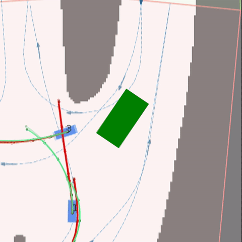

# MineSim-MPC-AD-Control

**Strategy overlay** for the MineSim / mine_sim mining AD planning-control track.

- **Online baseline (v58, 183 scenes):** ≈ **96.12**
- **Local best (v63):** public40 ≈ **97.57**, known43 ≈ **97.10** (not the online package)
- **License:** AGPL-3.0 (same family as upstream mine_sim) — see `LICENSE` / `NOTICE`
- **Form:** overlay only — bring your own official mine_sim + data

<p align="center">
  
</p>

Demo MP4s: [Release `v63-demo-videos`](https://github.com/cainiao33/MineSim-MPC-AD-Control/releases/tag/v63-demo-videos).

## Quick start

```bash
# 1) Obtain official mine_sim (with inputs/ + maps)
# 2) Apply overlay
bash scripts/overlay_into_minesim.sh /path/to/mine_sim

# 3) Run a public scenario from that tree
python devkit/__main__.py --scenario Scenario-dapai_intersection_1_3_10.json --visualize none
```

## Docs

| File | Content |
|---|---|
| [METHOD.md](METHOD.md) | Replay timing + adaptive bank + SAS/STPP/SQP |
| [ARCHITECTURE.md](ARCHITECTURE.md) | Module map + config discovery |
| [SCORES.md](SCORES.md) | Online vs local score hygiene |
| [MANIFEST.json](MANIFEST.json) | Per-file sha256 of the overlay |

Chinese README: [README.md](README.md).
