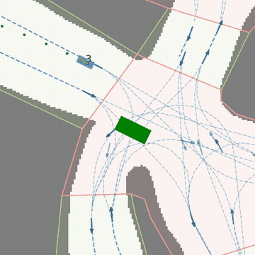
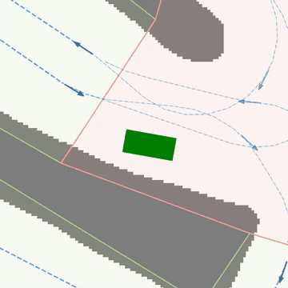
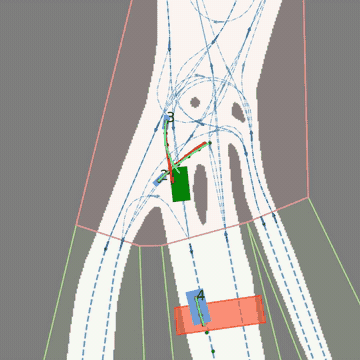
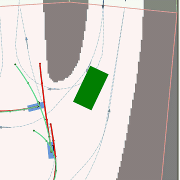
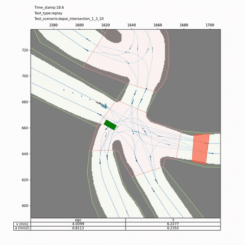
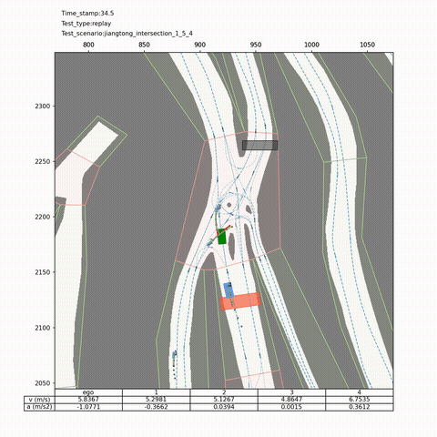
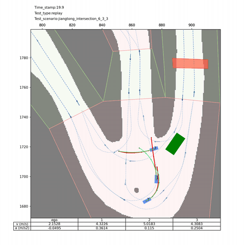
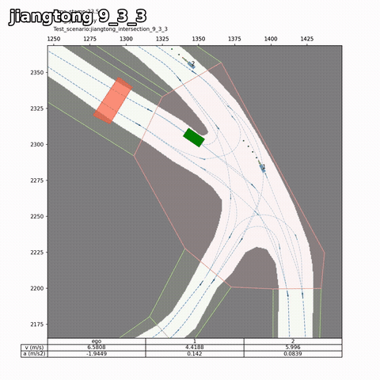

# MineSim-MPC-AD — Mining AD Planning/Control Overlay (on MineSim)

<p align="center">
  <a href="README.md"></a>
  <a href="README_en.md"></a>
</p>

> **Competition:** [Pazhou Algorithm Competition × Intelligent Driving Ecosystem Track](https://deepvision.aicompetition-pz.com/#/homeDetail?id=2095413633562579532) — **planning / decision / control** task (MineSim replay). Official site: [aicompetition-pz.com](https://www.aicompetition-pz.com/) · Detail page: [deepvision platform](https://deepvision.aicompetition-pz.com/#/homeDetail?id=2095413633562579532).
>
> **Overview:** A **strategy overlay** for the MineSim / mine_sim replay simulator — scene-adaptive config bank + SAS same-code closed-loop candidates + STPP / retiming feed-forward + v63 full-trace SQP / goal-polygon dispatch. Overwrites contestant `devkit/` only; Env / maps / scorer stay stock.
>
> **Results:** Bindable online package **v58 ≈ 96.12** (183-scene mean 96.121366…) · Local best **v63** public40 ≈ **97.57** / known43 ≈ **97.10** (zero vehicle / boundary collisions; **not** the online package).
>
> **How to run:** Bring your own official mine_sim (with `inputs/` + maps). This repo ships strategy files only:
>
> ```bash
> git clone https://github.com/cainiao33/MineSim-MPC-AD-Control.git
> bash MineSim-MPC-AD-Control/scripts/overlay_into_minesim.sh /path/to/official_mine_sim
> cd /path/to/official_mine_sim
> python devkit/__main__.py --scenario Scenario-dapai_intersection_1_3_10.json --visualize none
> ```
>
> Demos: [follow-cam](https://github.com/cainiao33/MineSim-MPC-AD-Control/releases/tag/v63-demo-videos) · [wide/map view](https://github.com/cainiao33/MineSim-MPC-AD-Control/releases/tag/v63-demo-videos-wide). Task/data: [TASK_AND_DATA_en.md](TASK_AND_DATA_en.md). Method: [METHOD.md](METHOD.md) / [ARCHITECTURE.md](ARCHITECTURE.md).

[](https://www.python.org/downloads/)
[](LICENSE)
[](https://deepvision.aicompetition-pz.com/#/homeDetail?id=2095413633562579532)
[](NOTICE)
[](SCORES.md)

---

## 📖 Introduction

Open-source slice of the **planning & control** track from the **[Pazhou Algorithm Competition × Intelligent Driving Ecosystem Track](https://deepvision.aicompetition-pz.com/#/homeDetail?id=2095413633562579532)**. On the organizer’s MineSim replay benchmark, an interpretable rule stack plus an empirical bank raised scores to **v58 ≈ 96.12** (online) / **v63 ≈ 97.1** (local known-43).

Approach: **do not replace the simulator** — Env, maps, and the official scorer stay unchanged. Contestant-facing changes live in `planner` / `predictor` / `simple_control`, plus SAS, STPP, and full-trace SQP modules. The full 183-scene `scen_config.json` ships with the repo as part of the “scene-adaptive strategy selection” method.

### What this repo changes (vs stock mine_sim `devkit/`)

- **🗺 Path bank:** per-scene `modes` (base / center / hybrid) + offline centerlines + `*_v2s` surgical table
- **⏱ Speed / car-following:** `vel0` / `vprof` / IDM / yield keys; single-variable A/B with bank / rollback
- **🛡 Safety tracking:** `alat` / `rot` / look caps aligned with scoring side-acceleration and steering limits
- **🔁 SAS v2:** same-code closed-loop candidate rollouts (stock plant / controller / scorer)
- **📐 STPP + retiming FF:** reshape executed timing on the certified safety model (v58 online lineage)
- **🎯 v63 full-trace SQP + goal polygon:** refine selected native-safe tables; keep original `HYST`

> Official `inputs/`, HD maps, hidden trajectories, and Docker images are **not** redistributed. Upstream is AGPL-3.0 — see [LICENSE](LICENSE) / [NOTICE](NOTICE).

---

## 🏆 Results

| Item | Content |
|------|------|
| **Competition** | [Pazhou Algorithm Competition × Intelligent Driving Ecosystem Track](https://deepvision.aicompetition-pz.com/#/homeDetail?id=2095413633562579532) |
| **Track** | Planning / decision / control (Preliminary B / Final B) |
| **Official links** | [Problem detail](https://deepvision.aicompetition-pz.com/#/homeDetail?id=2095413633562579532) · [Competition site](https://www.aicompetition-pz.com/) |

| Metric | Value |
|------|------|
| **Bindable online baseline** | **v58-full-ff ≈ 96.12** (183-scene mean 96.121366…) |
| **Local public 40** | **v63 = 97.572355** |
| **Local known 43** | **v63 = 97.096258…** (all arrive · zero crash · zero curb) |
| **Early public ladder** | baseline ~74 → fin2 ~90.23 (historical local-40) |
| **Platform first → certified** | 82.00 → … → v54 ≈95.996 → **v58 ≈96.12** |

**Hygiene:** local 43 ≠ online 183; v63 is the local production best and was **not** bound as the online package. Details: [SCORES.md](SCORES.md).

<p align="center">
  
</p>
<p align="center">
  
</p>

---

## 📋 Task & dataset

| Item | Content |
|------|------|
| **Competition** | [Pazhou × Intelligent Driving](https://deepvision.aicompetition-pz.com/#/homeDetail?id=2095413633562579532) |
| **Task** | Output steering / throttle / brake from perception + pose / nav / dynamics at unsignalized intersections with dynamic interaction |
| **Score** | Safety 50% + efficiency 30% + path completion 20% |
| **Dataset (official)** | Pose, nav, dynamics, perception; unstructured unsignalized intersections; same schema prelim/finals, different distribution |
| **Public pack** | 2 maps (Dapai / Jiangtong) · **40** public scenes · baseline + README; online ~**183** scenes |
| **Demo 11** | dapai `1_3_10/1_3_15/2_3_5/3_2_2` · jiangtong `1_5_3/1_5_4/5_4_1/6_2_5/6_3_3/9_3_2/9_3_3` |

Full write-up: [TASK_AND_DATA_en.md](TASK_AND_DATA_en.md) · Chinese [TASK_AND_DATA.md](TASK_AND_DATA.md). Official data is **not** shipped here.

---

## 🎥 Demo

Two render views; same sealed v63 trajectories (post-process does not change sim).

| View | What you see | Full MP4s |
|------|------|----------|
| **Follow-cam** | Ego lock · EMA · 1080² | [Release `v63-demo-videos`](https://github.com/cainiao33/MineSim-MPC-AD-Control/releases/tag/v63-demo-videos) (~144MB) |
| **Wide / map** | 1500² panorama — full map, agents, route | [Release `v63-demo-videos-wide`](https://github.com/cainiao33/MineSim-MPC-AD-Control/releases/tag/v63-demo-videos-wide) (`wide_*`, ~55MB) |

### Follow-cam previews

<p align="center">
  
  
  
  
</p>

Highlight reel: [`v63_highlights_1080.mp4`](https://github.com/cainiao33/MineSim-MPC-AD-Control/releases/download/v63-demo-videos/v63_highlights_1080.mp4)

### Wide / map previews

<p align="center">
  
  
  
  
</p>

Wide highlights: [`wide_v63_highlights_1080.mp4`](https://github.com/cainiao33/MineSim-MPC-AD-Control/releases/download/v63-demo-videos-wide/wide_v63_highlights_1080.mp4)

Per-scene 1x / 0.5x links for all 11 scenes are listed in the Chinese [README.md](README.md#成片清单11-场--双倍速--双视角) table.

---

## ⚠️ Reproduction notes

This repo is a **strategy open-source** (overlay + narrative + demos), not a standalone full simulator drop:

- You must obtain **official mine_sim** and authorized contest data
- Online 183 hidden inputs and the platform Docker judge are **out of tree**
- The overlay script rewrites NEW/MOD files under `devkit/` and backs up stock copies once to `.mpc_ad_overlay_backup/`
- `planner.py` / `simple_control.py` / `sas_hook.py` were **path-scrubbed** for portability; public hashes for those three differ from the frozen lab — see [MANIFEST.json](MANIFEST.json)

Readers with the official package can overlay and run public scenes; others can treat this as an engineering reference for replay-style planning/control.

---

## 📦 Quick overlay

```bash
git clone https://github.com/cainiao33/MineSim-MPC-AD-Control.git
bash MineSim-MPC-AD-Control/scripts/overlay_into_minesim.sh /path/to/official_mine_sim
cd /path/to/official_mine_sim
python devkit/__main__.py \
  --scenario Scenario-dapai_intersection_1_3_10.json \
  --visualize none
```

| Env var | Role |
|------|------|
| `MINE_SCEN_CONFIG` / `MINE_CFG` | Explicit `scen_config.json` |
| `MINE_CENTERLINE_DIR` | Centerline directory |
| `MINE_EXPECTED_JSON` | Optional expected-time table |

Default: `devkit/centerlines/scen_config.json`.

---

## 🧠 Method in brief

1. **Replay timing:** non-reactive background agents; naive ego retiming / reroute creates self-inflicted conflicts.  
2. **Three-layer adaptive bank:** path → speed/IDM/yield → alat/rot/look; single-variable A/B with free rollback.  
3. **Production stack:** SAS closed-loop → STPP/retiming FF (v58) → v63 full-trace SQP + goal polygon.

| Doc | Content |
|------|------|
| [TASK_AND_DATA_en.md](TASK_AND_DATA_en.md) | Task, scoring, dataset, public scenes |
| [METHOD.md](METHOD.md) | Four-act method narrative |
| [ARCHITECTURE.md](ARCHITECTURE.md) | Module map + config discovery |
| [SCORES.md](SCORES.md) | Online vs local score ledger |
| [MANIFEST.json](MANIFEST.json) | Per-file sha256 (58 overlay files) |

Chinese README: [README.md](README.md).

---

## 📄 License & upstream

- Upstream simulator: MineSim / mine_sim (**AGPL-3.0**)
- This overlay is released under AGPL-3.0; combined use with the official tree inherits copyleft duties
- See [NOTICE](NOTICE) for attribution and non-redistribution of official data
