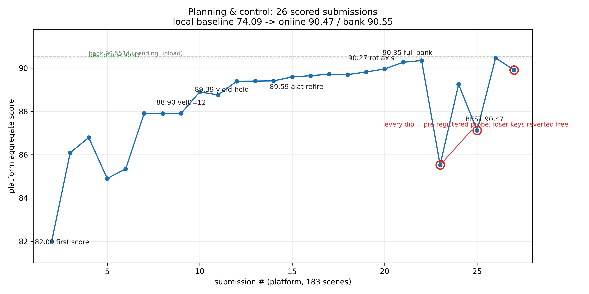
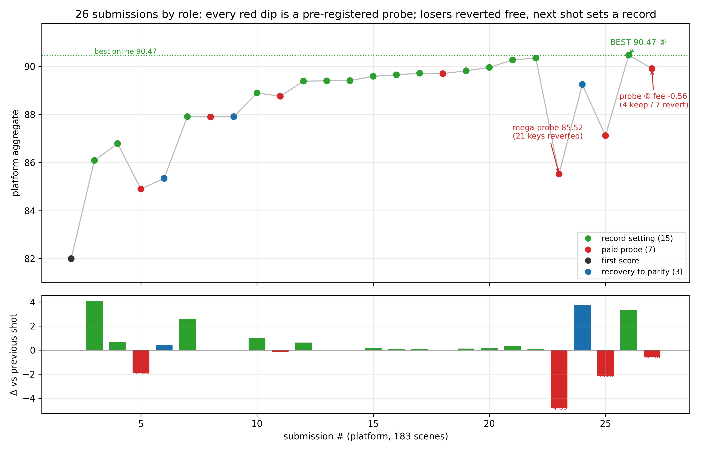

# 分数说明

请分开记录：**线上 183 场** 与 **本地 40 / 43 场**，不要互相替代。

## 主要数字

| 范围 | 版本 | 分数 | 说明 |
|---|---|---:|---|
| 线上（183 场） | **v58-full-ff** | **96.121366…**（显示约 96.12） | 已提交的 Docker 版本 |
| 本地公开 40 场 | **v63** | **97.572355** | 官方本地评分器 |
| 本地 43 场（公开 40 + 3 个已知隐藏场） | **v63** | **97.096258…** | 该集合上零碰撞、零压界 |
| 榜单快照 | — | 约 96.1252（当时第 4） | 快照不等于某一包文件哈希 |

v63 **没有**作为线上提交版本上传；线上引用以 v58 为准。

## 早期公开集（本地，历史）

公开开发集上的大致过程（不是 183 场均分）：

`基线约 74 → … → 约 89 → 约 90.23`

随后平台首评 **82.00**（183 场）暴露隐藏场景落差，后续通过场景自适应配置与代码改进逐步追回。

## 线上提交里程碑（节选）

| 版本 | 线上约分 | 要点 |
|---|---:|---|
| v1 | 82.00 | 首次上线 |
| v6 | 87.91 | 路径模式 / 速度 / 加速度参数合并 |
| v11 | 89.39 | 让行至超时 |
| v20 | 90.27 | 首次突破 90（转角约束） |
| v25 | 90.47 | 侧向加速度参数 + 试探提交 |
| v32 | 90.61 | 精确对时（少量接管场景） |
| v41–v43 | 92.24→92.40 | SAS 闭环搜索与预算控制 |
| v54 | 95.995956 | STPP 几何 |
| **v58** | **96.121366** | 完整前馈 / 重定时 |

提分曲线与提交类型示意：

## 剩余差距（背景）

相对 99 分目标，v58 的剩余损失主要集中在若干地图场景族（效率与安全），而不是某一个公开场。v57 / v58 在共有场景上本地与线上可对齐；其余隐藏场只能通过平台读数得知。
